# Why ADR cannot push the `ball_lateral` edge (2026-10-14 to 10-16)

Analysis of the ADR runs with built-in-bot probes, goal-centre ball shaping and
`ball_lateral` starting at ±0.08 (this branch; Torch
`/scratch/fyy2003/experiments/football-adr-bot-ladder-20261014`, jobs
19820209/10/11, seeds 0-2, `SEED_BASE` 20261002, 5B steps, thresholds 0.3/0.6).
Every other ADR setting grew during training. `ball_lateral` stayed at ±0.08 to 0.10
and `ball_distance` at 0.19 to 0.23.

## Short answer

1. **The action space is not the wall.** With automatic aiming off (ADR scenes
   run with the magnet off), kicks go straight or about 37° diagonal, so a
   single kick can't score from wide balls close to the goal line. But a
   scripted "dribble in, then shoot" attacker using the same 19 actions scores
   0.62-1.0 against idle defenders everywhere on the y × distance grid.
2. **Training almost never needs anything but one kick.** Only 0.2-0.5% of
   training scenes are beyond one-kick reach, and only 8-15% of lateral-edge
   probes. The policies learned "straight or diagonal", which is optimal for
   what they saw, and never learned to carry the ball in first.
3. **At the edge itself, scenes are reachable and the policy mostly picks the
   right lane.** 92% of failed edge probes were one-kick reachable. When only
   a diagonal scores, the policy kicks diagonally 61% of the time (goal 0.52),
   at 12-25° 26% (0.39), and straight 13% (0.00).
4. **The biggest leak is not lateral at all: dead balls.** 27-34% of probe
   episodes, centred ones included, end at the timeout with the ball resting
   untouched. About a third of on-target first kicks are blocked or parried
   back to x ≈ 0.5-0.66, then neither the policy nor the bot touches the
   ball again. This caps probe success near 0.65-0.7, so edges rarely reach 0.6.
5. **One step past the edge is a cliff** (probe success 0.05-0.3): half of
   those scenes need a dribble the policy never learned.

## Plots

### Final policies on clean start scenes (ball y swept, 0.1 and 0.3 out)

| | |
|---|---|
| 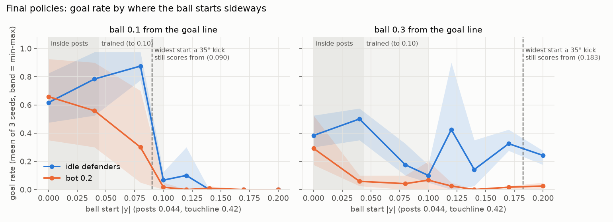 | **Goal rate by start y.** Against idle defenders the goal rate falls from 0.87 at y = 0.08 to 0.07 at y = 0.10 (0.1 out). The dashed line is the widest start a ~35° kick still scores from (0.090 at 0.1 out, 0.183 at 0.3 out). |
| 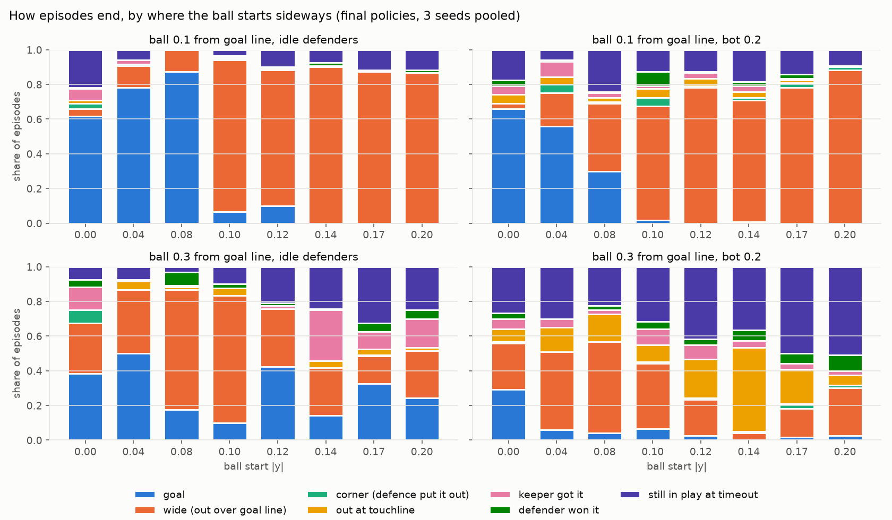 | **How episodes end.** From 0.1 out and y ≥ 0.10, 85-95% of episodes go wide over the goal line. Losing it at the touchline only shows up from 0.3 out against the bot. |
| 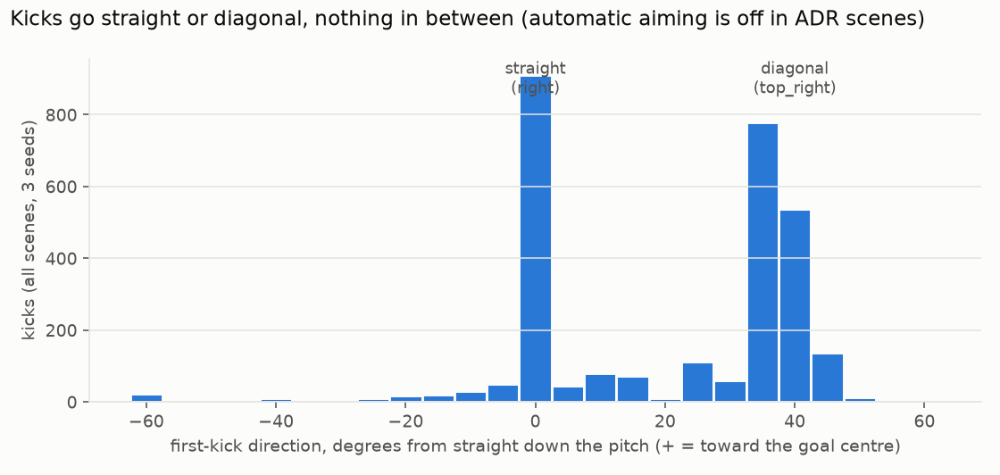 | **Kick angles.** Kicks go straight (0°) or diagonal (35-45°). The 5-30° kicks come from changing direction while a buffered kick press is taken, and the 37° peak (rather than 45°) comes from the engine adding a forward offset to long passes. |
| 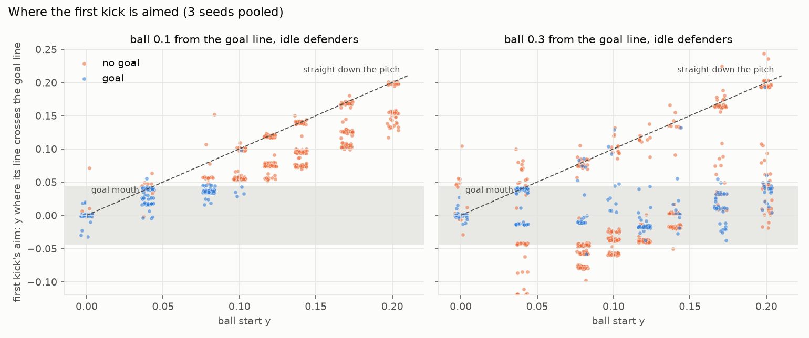 | **Where the first kick is aimed** (the y where its line crosses the goal line, against start y; the dashed line is "straight down the pitch"). Aims form bands parallel to the dashed line, a fixed step inside it, so they move out in step with the start position. From 0.3 out at y = 0.04-0.10 the diagonal overshoots the far post, which is a dead gap between the lanes. |
| 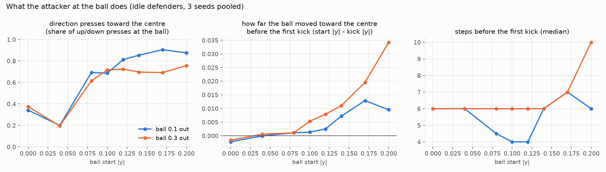 | **The attacker at the ball** presses toward the centre (70-90% of its up/down presses), but kicks after 4-7 steps and moves the ball in by only 0.005-0.03. |
| 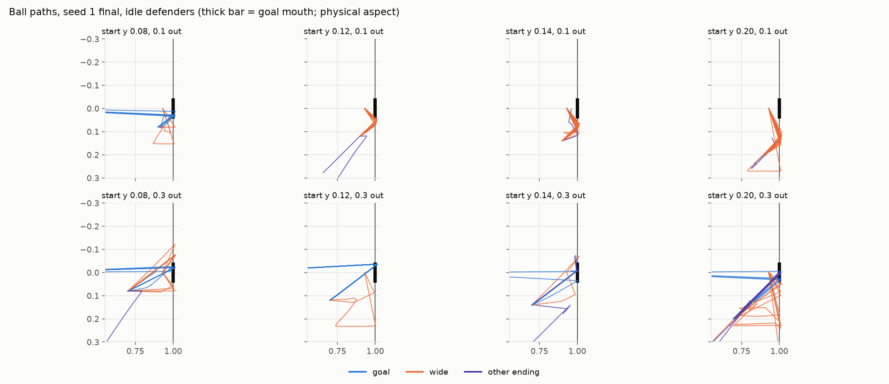 | **Ball paths** (seed 1, idle defenders): a short jab inward, then out along the goal line. |
| 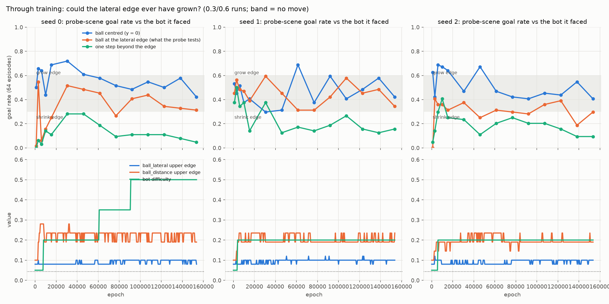 | **Probes replayed through training** (checkpoints vs the bot they faced, scenes from that epoch's ranges). Probes at the edge score 0.25-0.55, inside the "no move" band. Centred balls score only 0.4-0.7. One step beyond scores 0.05-0.3. Bottom row: the lateral edge, the distance edge and the bot difficulty over training. |

The first-kick detection behind `side_3`/`side_4`/`side_7` counted any fast ball
movement, so some fast dribble touches are counted as kicks. The kick angles
and lane choice in `analyze_kicks.py` use the corrected detection (a kick
button pressed within 25 steps, then the ball speeds past 0.02/step).

### Geometry, policy vs script, and the probe post-mortem

| | |
|---|---|
| 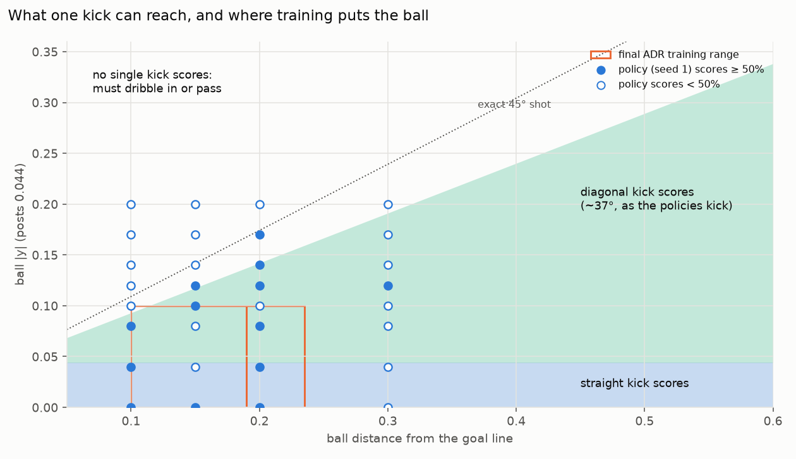 | **What one kick can reach.** Blue: a straight kick scores. Green: the policies' ~37° diagonal scores. Orange boxes: the final ADR training ranges, almost all inside one-kick reach. Over the full ADR limits, 25% of positions are beyond one kick (18% with an exact 45° shot). |
| 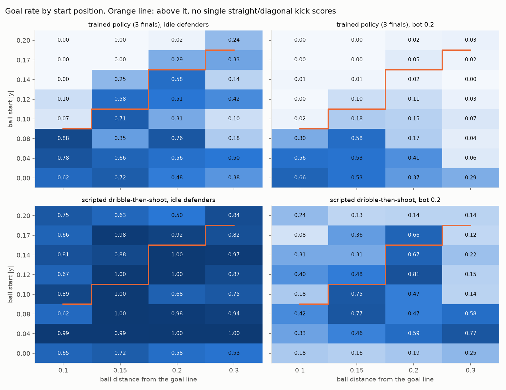 | **Goal rate over y × distance.** Policy against the scripted dribble-then-shoot attacker, idle defenders and bot 0.2. Above the orange line no single kick scores. The policy is about 0 there; the script scores 0.5-1.0 against idle defenders. |
| 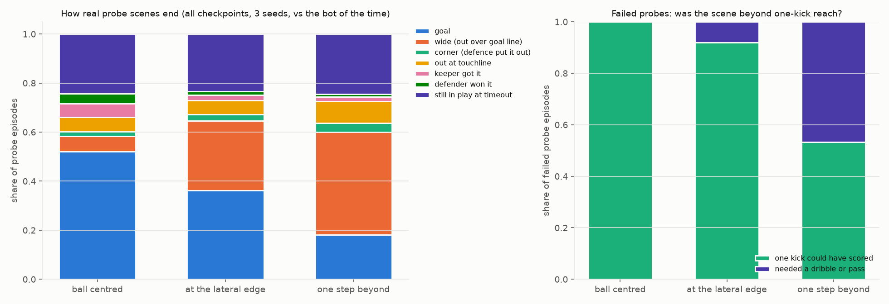 | **How real probe scenes end** (126 checkpoint × scene cells, 40 episodes each). At the edge: 36% goals, 28% wide, 23% timeouts. 92% of failed edge probes were one-kick reachable. |
| 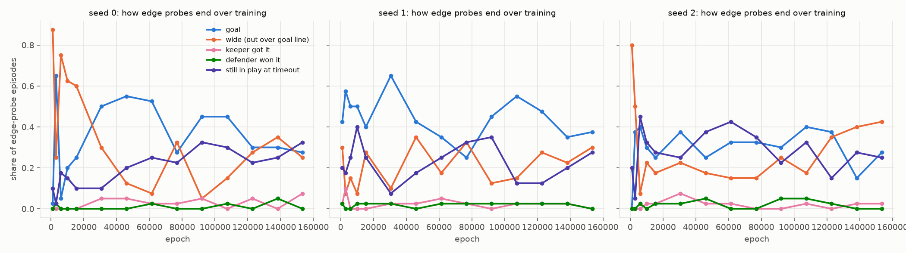 | **Edge-probe outcomes over training.** Early on, wide misses dominate (75-87%). Later, goals sit at 0.25-0.55, with wide misses and timeouts splitting the rest. Keeper saves and defender tackles stay under 0.1. |

### Frame strips of timeout episodes (`frames/`)

Renders of the two edge-probe cells with the most timeouts (seed 2 epoch
61,400; seed 0 final), 12 frames per episode. The overlay reads "BALL OWNED:
---" for 300+ steps, and the attackers run off in one direction pressing
`sliding` and pass buttons. In 7 of the 12 timeouts the ball never moves; in
the other 5 it is kicked once and then left.

## Numbers behind the main claims

- **Scripted attacker against idle defenders**, ball 0.1 out: y = 0.14 / 0.17 / 0.20 score 0.81 / 0.66 / 0.75. The policy scores 0 at all three.
- **Lane choice at the edge** (button-confirmed kicks, scenes where only a diagonal scores, 1,238 kicks): diagonal 61% (goal 0.52), 12-25° 26% (0.39), straight 13% (0.00).
- **On-target first kicks** reach the goal line within 60 steps only 64-80% of the time, whatever the button (`long_pass`, `short_pass`, `shot`, `high_pass` all score 0.54-0.65). Those that fall short leave at the same speed and end 60 steps later at x ≈ 0.46-0.66: blocked or parried, then left lying.
- **Timeouts:** 93-97% end with the ball at rest for the last 150+ steps. Timeout rates are the same whether the ball starts loose or at the carrier (0.23-0.35).
- **Symmetry check:** −y gives the same picture (`bottom_right` instead of `top_right`, the same 35-42° kicks, the same wall).

## Reproducing

Scripts are in `scripts/`. The data (about 60 MB of JSON) lives on Torch under
`.../football-adr-bot-ladder-20261014/{side_20261015,edge_history_20261015}`.
Copy it into this folder as `side/`, `proof/`, `history/`, `autopsy2/` and
`logs/` (gitignored), then:

```shell
uv run --no-project --with matplotlib --with numpy python scripts/plot_side.py
uv run --no-project --with matplotlib --with numpy python scripts/plot_deep.py
uv run --no-project --with numpy python scripts/analyze_kicks.py
```

- `side_trace.py` produces every trace. It covers: the clean scene with `--lateral` and `--distance`; real probe scenes with `--adr-log`; the scripted attacker with `--scripted`; `--kick-to-shot` with a patched aim-assist engine (that build segfaulted, so it's unused); and `--video-dir` (renders, GPU node only).
- `edge_history_setup.py` builds the probe-replay configs.
- `contact_sheets.py` makes the frame strips (OpenCV; no ffmpeg on Torch).
- CPU sweeps ran on the `cs` partition. `cpu_short` caps a user at 32 CPUs.

## Directions (not implemented)

1. **Dead balls first:** turn on the existing player-to-ball shaping (`PLAYER_POTENTIAL`, with the fade-out for kicked balls). It is potential-based, so it doesn't change what the best policy is. Also end a probe as a failure once the ball has rested untouched for about 50 steps.
2. **The cliff past the edge:** put some scenes beyond one-kick reach into training (wider balls further from the goal line, or practice past the edges).
3. **Later:** a kick angle separate from the run direction (an engine change, and a larger action space).
